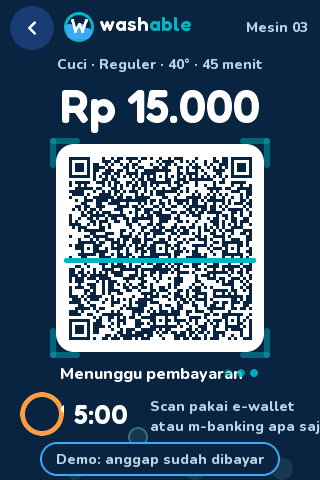
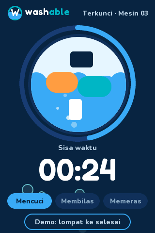
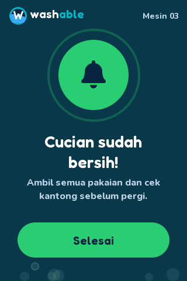

# washable

Firmware monorepo for the **washable** self-service laundry kiosk: a touch-screen ESP32 kiosk (UI, QRIS payment, membership, OTA updates)
and an STM32 controller that switches the relays of the wash machine and the dryer.

```
esp32-kiosk/   ESP32-3248S035 kiosk firmware      (PlatformIO, Arduino, LVGL)       -> esp32-kiosk/README.md
stm32-relay/   STM32G030F6P6 relay controller     (PlatformIO, STM32duino)           -> stm32-relay/README.md
shared/        code used by both firmwares        (relay_proto: CRC, framing, JSON field helpers)
tests/         host tests that span both projects (run_host_tests.sh, integration/)
docs/          relay-protocol.md                  the ESP32 <-> STM32 serial JSON protocol
docs/img/      screenshots (docs/img/screens) and wiring / pinout drawings
tools/         release.py (kiosk release builder), stm32_sim.py (STM32 simulator),
               sim/ (renders the kiosk screens on a PC), diagrams/ (generates the SVG drawings)
.github/       CI (build + tests) and the release workflows
washable.code-workspace   VS Code multi-root workspace (one PlatformIO project per folder)
```

```
 ┌────────────────────┐  UART0 115200, JSON lines + CRC16   ┌──────────────────────────┐
 │  ESP32-3248S035    │ GPIO1 TX ───────────────────> PA3   │  STM32G030F6P6 (WeAct)   │── 8 relays
 │  kiosk (esp32-kiosk)│ GPIO3 RX <─────────────────── PA2   │  relay controller        │   1-4 wash, 5-8 dry
 └────────────────────┘                                     └──────────────────────────┘
```

<p align="center">
    
</p>

All pages, wiring and flows: [esp32-kiosk/README.md](esp32-kiosk/README.md) (kiosk, screenshots, serial link) and [stm32-relay/README.md](stm32-relay/README.md) (board pinout, relay wiring, controller flow).

## Quick start

```bash
# kiosk firmware
pio run -d esp32-kiosk                  # build
pio run -d esp32-kiosk -t upload        # flash over USB

# relay controller firmware
pio run -d stm32-relay                  # build
pio run -d stm32-relay -t upload        # flash with an ST-Link

# tests (no hardware needed)
./tests/run_host_tests.sh
```

Regenerate the screenshots after a UI change with `tools/sim/screenshots.sh` (needs one `pio run -d esp32-kiosk` first for the LVGL sources) and the drawings with `python3 tools/diagrams/gen_diagrams.py`.

Open `washable.code-workspace` in VS Code so the PlatformIO extension sees each project (a PlatformIO project is a folder with a `platformio.ini`).

## Releases and tags

| Tag | What | Workflow |
|---|---|---|
| `v1.2.0` | **Kiosk firmware** release. Attaches `firmware.bin` + `manifest.json`; the kiosks update themselves from `releases/latest/download/manifest.json`. | `.github/workflows/esp32-release.yml` |
| `stm32-v0.2.0` | Relay controller firmware (`stm32-relay-0.2.0.bin`). Published with `--latest=false` so it can never become the repo's *latest* release. | `.github/workflows/stm32-release.yml` |

Keep it that way: the kiosks' OTA URL always resolves to the *latest* release, so only `v*` kiosk releases may be "latest".
Every push and pull request runs `.github/workflows/ci.yml` (host tests, ESP32 build, STM32 build).

## Working on the protocol

`shared/relay_proto/relay_proto.h` is the single source of truth for framing, CRC and field parsing; both firmwares and the host tests include it.
Protocol changes go in `docs/relay-protocol.md`, `stm32-relay/src/ctrl_core.h` (controller), `esp32-kiosk/src/relay_link.cpp` (kiosk) and are covered by `./tests/run_host_tests.sh`.
