# washable - ESP32 kiosk firmware

> Part of the [washable monorepo](../README.md) (this folder = `esp32-kiosk/`; the relay controller is in [`../stm32-relay/`](../stm32-relay/)).

Touch-screen kiosk firmware for the **ESP32-3248S035** (3.5" 320x480 ST7796 display, GT911 capacitive touch, on-board RGB LED).
Customers pick a wash or dry program, pay with **QRIS**, and watch an animated progress screen while the machine runs.
Owners configure the kiosk from the touch screen or from a PC browser, and the firmware updates itself over the internet (OTA).

The UI is in Indonesian and follows the "Washable" design (navy / teal / blue / orange / mint, Fredoka + Nunito fonts), in portrait.

## The board

[CYD ESP32-3248S035](https://www.espboards.dev/esp32/cyd-esp32-3248s035/) ("Cheap Yellow Display", Sunton): ESP32-WROOM-32 (4 MB flash), 3.5" 320x480 ST7796 display, GT911 capacitive touch, on-board RGB LED, micro-SD, speaker, Micro-USB + USB-C.
Full pinout and datasheet: [espboards.dev](https://www.espboards.dev/esp32/cyd-esp32-3248s035/).


The kiosk uses the **P1 serial connector** (4P 1.25 mm: VIN, IO1/TX, IO3/RX, GND) to talk to the relay controller, see [Wiring](#wiring-to-the-relay-controller).

## Screenshots

Every page of the kiosk (320x480 portrait). They are rendered on a PC from the **real UI code** of `src/main.cpp` with LVGL (`tools/sim/screenshots.sh`), with sample data, so they match what the board draws; regenerate them after any UI change.

<table>
<tr><td align="center"><br><sub>Idle</sub></td><td align="center">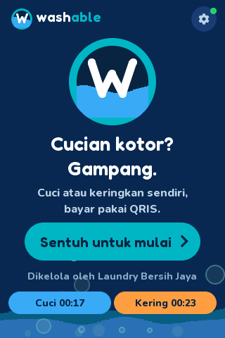<br><sub>Idle, machines running</sub></td><td align="center">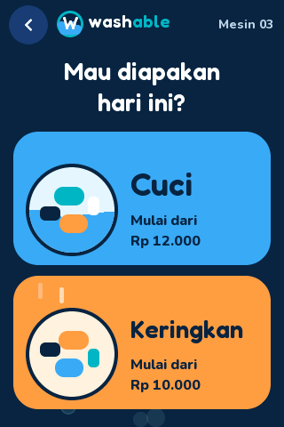<br><sub>Choose service</sub></td><td align="center">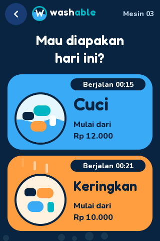<br><sub>Service, machines in use</sub></td><td align="center"><br><sub>Member?</sub></td></tr>
<tr><td align="center">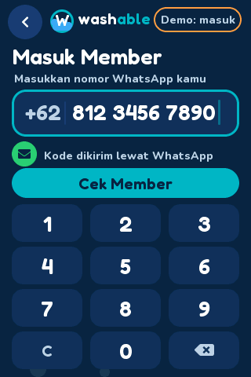<br><sub>Phone number</sub></td><td align="center"><br><sub>Checking member</sub></td><td align="center">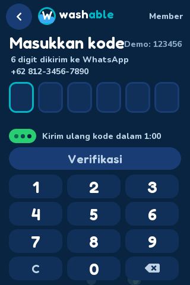<br><sub>WhatsApp code</sub></td><td align="center"><br><sub>Member home</sub></td><td align="center">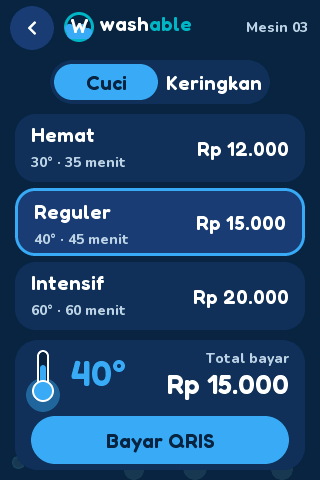<br><sub>Wash programs</sub></td></tr>
<tr><td align="center">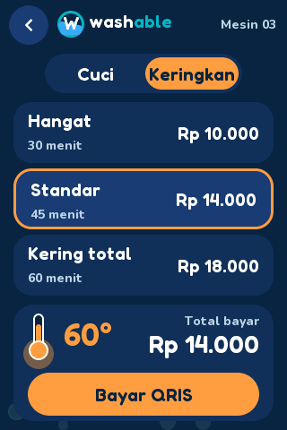<br><sub>Dry programs</sub></td><td align="center">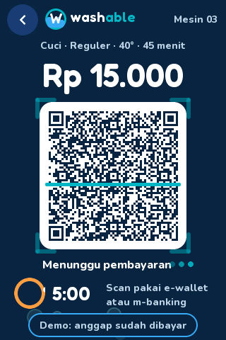<br><sub>QRIS payment</sub></td><td align="center">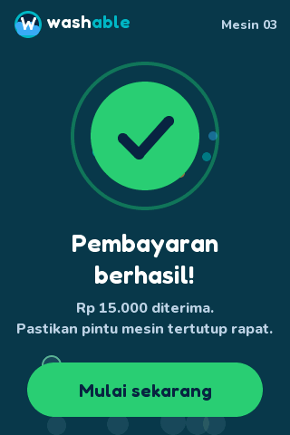<br><sub>Payment success</sub></td><td align="center">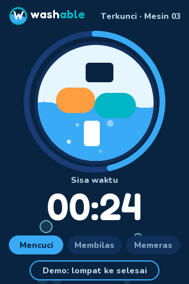<br><sub>Washing</sub></td><td align="center">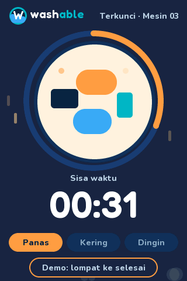<br><sub>Drying</sub></td></tr>
<tr><td align="center"><br><sub>Cycle done</sub></td><td align="center">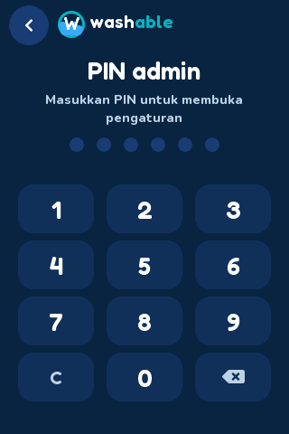<br><sub>Admin PIN</sub></td><td align="center">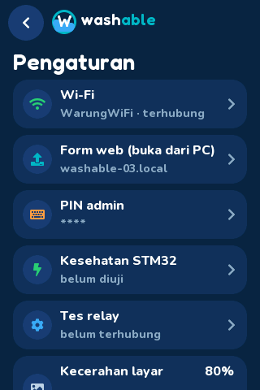<br><sub>Settings</sub></td><td align="center">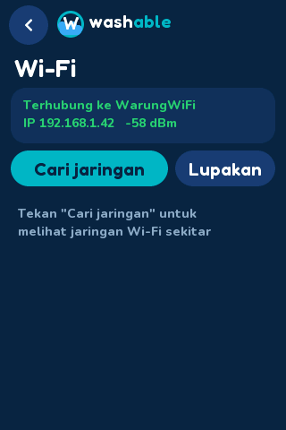<br><sub>Wi-Fi</sub></td><td align="center">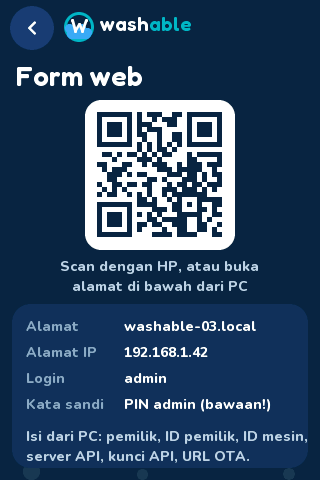<br><sub>Form web (QR + address)</sub></td></tr>
<tr><td align="center">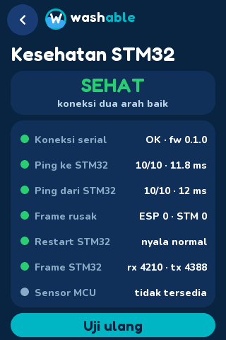<br><sub>STM32 health: healthy</sub></td><td align="center">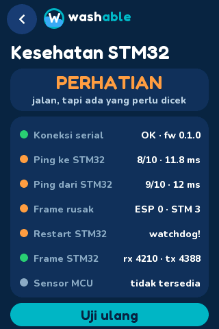<br><sub>STM32 health: attention</sub></td><td align="center">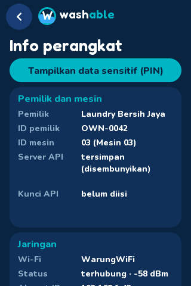<br><sub>Device info (top)</sub></td><td align="center">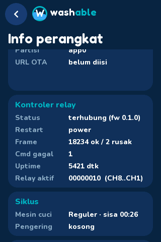<br><sub>Device info (controller, cycles)</sub></td><td align="center">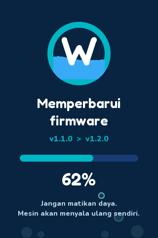<br><sub>Firmware update</sub></td></tr>
</table>

### English

The same pages in English (the **EN** button on the first page):

<table>
<tr><td align="center"><br><sub>Idle</sub></td><td align="center">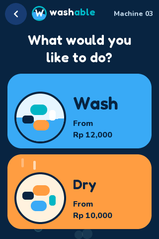<br><sub>Choose service</sub></td><td align="center">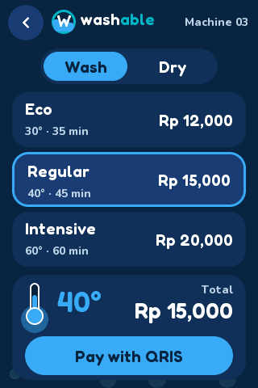<br><sub>Wash programs</sub></td><td align="center">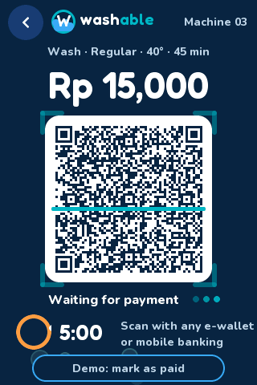<br><sub>QRIS payment</sub></td><td align="center"><br><sub>Washing</sub></td></tr>
<tr><td align="center"><br><sub>Member?</sub></td><td align="center"><br><sub>Member home</sub></td><td align="center">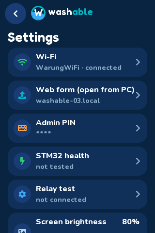<br><sub>Settings</sub></td><td align="center">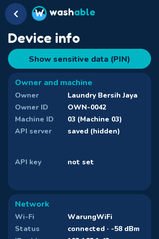<br><sub>Device info</sub></td><td align="center">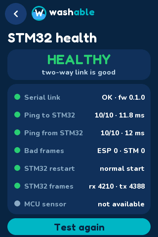<br><sub>STM32 health</sub></td></tr>
</table>

## Features

- **First page**: only the "Sentuh untuk mulai" button continues (touching elsewhere does nothing). The header row holds the **ID | EN** toggle, an **"i" information button** (public page with the machine name, operator, Wi-Fi state, firmware version and a three-step how-to; the "i" is green when Wi-Fi is connected, orange when not) and the settings gear.
- **Two languages**: an **ID | EN** toggle on the first page switches the whole kiosk (all pages, the PC web form and update messages) between Indonesian and English; the choice is saved and survives updates. All texts are in one table (`src/i18n.cpp`, `tr("indonesian text")` returns the English text); to add a language, add a column there.
- **Customer flow**: Idle -> choose service (Cuci / Keringkan) -> member? -> choose program -> pay with QRIS -> payment success -> washing / drying -> cycle done.
- **Wash and dry programs** with price, temperature and duration (Hemat / Reguler / Intensif, Hangat / Standar / Kering total).
- **QRIS payment page** with a real, scannable QR drawn as crisp vector modules from the QRIS payload, a 5-minute timer and a **demo "anggap sudah dibayar" button**.
- **Membership** (demo data, see below): phone number, WhatsApp code, points, coupons and vouchers.
- **Animated UI on every page** (bubbles, waves, tumbling drum, heat, confetti), tuned to run smoothly (20-65 refreshes/s measured on the device).
- **Admin settings** behind a 6-digit PIN: Wi-Fi, PIN, brightness, demo mode, device info, factory reset, restart.
- **Settings rows** (each opens its own page): Wi-Fi, **Form web** (QR code and address), PIN, **Kesehatan STM32**, relay test, brightness, demo mode, factory reset, restart, **Info perangkat**.
- **PC web form** (`http://washable-<id>.local`) for owner, owner ID, machine ID, API URL, API key and OTA URL.
- **Automatic OTA updates** from GitHub Releases, with SHA-256 check and rollback.
- **RGB status LED** (see colour code).
- **Relay controller link** to an STM32 over serial JSON (8 relays: 4 wash, 4 dry), with an installer **Tes relay** page. See [Relay controller](#relay-controller-stm32).
- **Settings survive updates**: stored in NVS plus a checksummed mirror in flash.

## Process flow

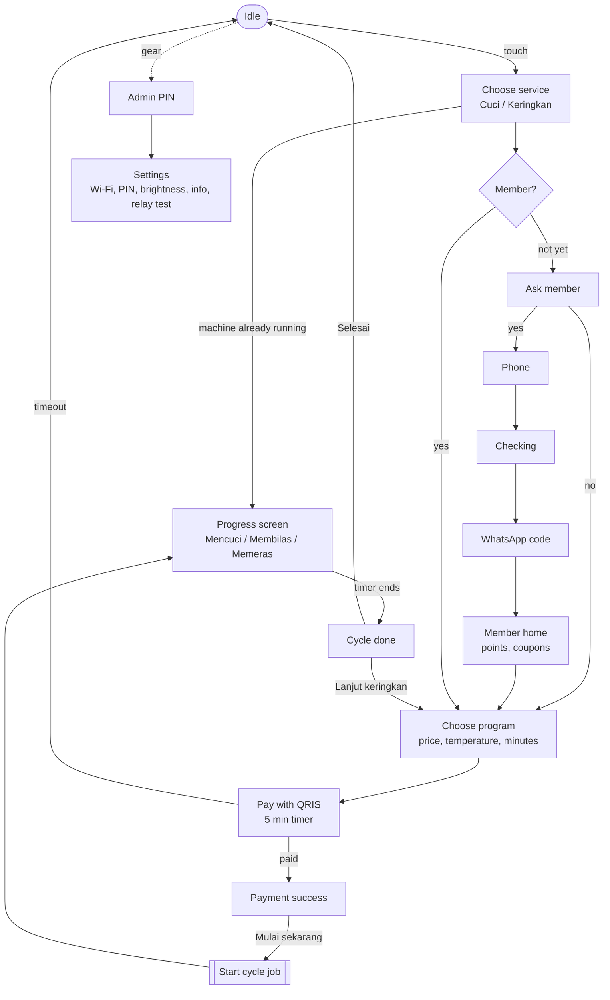

### Wash and dry run in parallel with the kiosk

A paid cycle is a **background job** (one for the wash machine, one for the dryer), independent of whatever page is on screen:

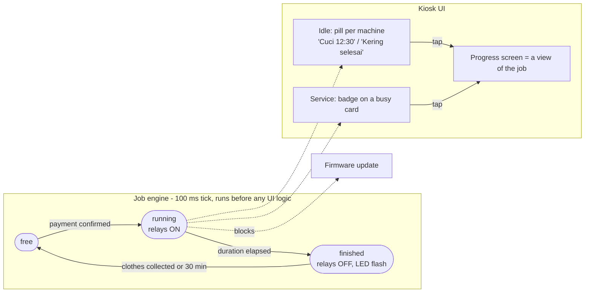

- While the wash runs, a customer can pay for and start drying, use membership, or the owner can open settings. Leaving the progress screen never stops a cycle.
- Tapping a busy machine's card (or its pill on the first page) opens its progress; a finished one opens "Cucian sudah bersih".
- The LED stays yellow while any job runs. OTA installs are refused while a job runs.

Pages switch with a backlight fade (no full-screen redraw), and each screen is built on entry and deleted on exit so only the visible page animates.

## RGB status LED colour code

The LED shows what the machine is doing. Higher rows win over lower ones.

| Situation | LED |
|---|---|
| Firmware update downloading | **blue**, pulsing |
| Error (payment timeout, wrong PIN, wrong member code, update failed) | **red**, 3 or 2 quick flashes |
| Payment received | **green**, 3 quick flashes |
| Cycle finished | **green**, 5 quick flashes |
| Wash / dry running, Wi-Fi connected | **yellow**, solid |
| Wash / dry running, Wi-Fi lost | **yellow / red** alternating |
| Waiting for QRIS payment | **yellow**, slow blink (yellow / red alternating if Wi-Fi lost) |
| Checking member / entering member code | **yellow**, fast blink |
| Admin pages (PIN, settings, Wi-Fi, editor) | **purple**, solid |
| Wi-Fi connecting (first 20 s after boot or after changing Wi-Fi) | **blue**, blinking |
| Wi-Fi connected and ready to process | **green**, solid |
| Wi-Fi lost and nothing running | **red**, solid |

At boot the LED shows red, green, blue once as a self-test. The LED is assumed to be on **GPIO 4 (red), 16 (green), 17 (blue), active-low**;
change `LED_R_PIN`, `LED_G_PIN`, `LED_B_PIN`, `LED_ACTIVE_LOW` and `LED_LEVEL` (brightness) at the top of the LED section in `src/main.cpp` if your board differs.

## Admin and configuration

- **Settings**: tap the gear on the first page and enter the admin PIN. The default PIN is **`123456`** (exactly 6 digits). Change it right away.
- **Wi-Fi**: scan, pick a network, type the password on the on-screen keyboard; "Lupakan" forgets the network.
- **PC web form**: while an admin page is open the kiosk serves a form on your network. Settings shows the addresses (`http://washable-<id>.local` and the IP).
  Login is user `admin` and the admin PIN as password; it locks for 60 s after 5 wrong logins. Fields: Pemilik, ID pemilik, ID mesin, Server API (URL), Kunci API (never shown again; empty keeps the stored key), URL manifest OTA.
  It is plain HTTP, so use it on a trusted network.
- **Info perangkat** (a row in Settings) opens its own scrolling page with cards for owner and machine (owner, owner ID, machine ID, API URL and key), network (Wi-Fi, status and signal, IP, MAC, web form address), firmware (version, update status, **date and time of the last OTA update** in WIB, build time, running partition, OTA URL), the relay controller (link, last restart reason, frame counters, relay mask), the two cycles (remaining time) and the system (uptime, free RAM, demo mode, brightness). The API URL and key stay hidden until you tap "Tampilkan data sensitif" and enter the PIN (visible for 30 s).
- **Demo mode** (Settings): 1 second per "minute" so cycles finish quickly. Turn it off for real durations.
- **Brightness**, **Reset pabrik** (double-tap to confirm) and **Mulai ulang** are in Settings too.
- Idle timeouts: customer pages return to the first page after 60 s, admin pages after 3 min.

## Membership (demo)

The member pages are implemented with **sample data**: any number is "found" as *Budi S. (Member Silver)*, the WhatsApp code is always `123456` (shown on screen as "Demo: 123456"), and points / coupons are kept in RAM only.
On the phone page the **"Demo: masuk"** button fills a sample number and runs the whole flow. Using a coupon or voucher does not change the price yet.
To make it real, replace the lookup, code check and points/coupon handling in the `MEMBERSHIP` section of `src/main.cpp` with calls to your backend (`cfg.apiUrl` + `cfg.apiKey`).

## Over-the-air updates

- The kiosk polls `manifest.json` from a GitHub release over **HTTPS** (certificate bundle embedded in `data/cert/`), about 2 minutes after boot and then every 6 hours, with back-off on failures.
- An update is installed **only** when the kiosk is on the first page, untouched for 5 minutes, inside the night window (01:00-05:00 WIB, needs NTP time), with enough free memory. Relays are switched off first.
- It downloads `firmware.bin` (same folder as the manifest), checks size and **SHA-256**, writes the other OTA slot and reboots.
- A new image that fails to start 3 times is **rolled back** to the previous one.
- Settings (NVS) are never touched by OTA; before each update they are written, read back and verified, and a checksummed copy lives in the SPIFFS partition (`/cfg.bak`) and is restored automatically if NVS is ever empty.
- The repository must be **public** (or the device needs a token) for the kiosks to download releases. Set the manifest URL in the web form:
  `https://github.com/<owner>/<repo>/releases/latest/download/manifest.json` (or set `OTA_DEFAULT_URL` in `src/ota.h`). Empty = updates off.
- Not implemented yet: **firmware signing**. Add an ECDSA signature check before using this on machines in the field.

### Publishing a release

```bash
git tag v1.2.0 && git push origin v1.2.0
```

The workflow `.github/workflows/esp32-release.yml` (tags `v*`) builds this folder and attaches `firmware.bin` and `manifest.json` to the release.
Locally, from the repo root: `python3 tools/release.py 1.2.0 --min-version 1.1.0` writes both files to `dist/`.
Only `v*` tags are kiosk releases: other firmware (e.g. `stm32-v*`) must never become the repository's *latest* release, or the kiosks' OTA URL would point at it (the STM32 workflow publishes with `--latest=false`).
`src/version.h` holds `FW_VERSION` (the release script and CI rewrite it).

## Build and flash

Requires [PlatformIO](https://platformio.org/). Run these in `esp32-kiosk/` (or use `pio run -d esp32-kiosk` from the repo root). The platform is pinned (`espressif32@6.12.0`) so every OTA build uses the same core.

```bash
pio run                        # build
pio run -t upload              # flash over USB
pio device monitor             # serial log, 115200 baud
```

- The partition table (`min_spiffs.csv`: two 1.9 MB OTA slots + 128 KB SPIFFS) is required for OTA. Changing from another table needs **one USB flash**; do **not** erase flash if you want to keep the saved settings.
- If upload fails at 921600 baud, the config already uses 460800.
- If the screen shows noise, lower `SPI_FREQUENCY` from 80 MHz to 40 MHz in `platformio.ini`; if colours are inverted try `TFT_INVERSION_ON`.
- If touches land in the wrong place, adjust `TOUCH_SWAP_XY`, `TOUCH_INVERT_X`, `TOUCH_INVERT_Y` in `src/main.cpp`.

## Hardware pins

| Function | Pins |
|---|---|
| Display (ST7796, SPI) | MOSI 13, MISO 12, SCLK 14, CS 15, DC 2, backlight 27 (PWM, used for page fades and brightness) |
| Touch (GT911, I2C 0x5D) | SDA 33, SCL 32, INT 21, RST 25 |
| RGB LED | R 4, G 16, B 17 (active-low) |
| Relay controller (STM32 serial link) | GPIO1 (TX0) -> STM32 PA3, GPIO3 (RX0) <- STM32 PA2, GND; 115200 8N1 (shared with the USB console, see below) |
| Direct relay pins (legacy) | `RELAY_WASH_PIN` / `RELAY_DRY_PIN` in `src/main.cpp`, disabled (-1); GPIO 21/25/32/33 belong to touch |

## Relay controller (STM32)

The ESP32 sends JSON lines (`{...}*CRC16`) over UART0 (GPIO1/GPIO3) to an **STM32G030F6P6** ([WeAct core board](../stm32-relay/README.md), USART2 on PA2/PA3) that switches 8 relays:
channels 1-4 for the wash machine, 5-8 for the dryer. The ESP32 decides what to switch and when; the STM32 enforces safety (all off at boot, every `on` has a time limit,
all off if the heartbeat stops for 3 s). Full protocol: [docs/relay-protocol.md](../docs/relay-protocol.md).

### Wiring to the relay controller

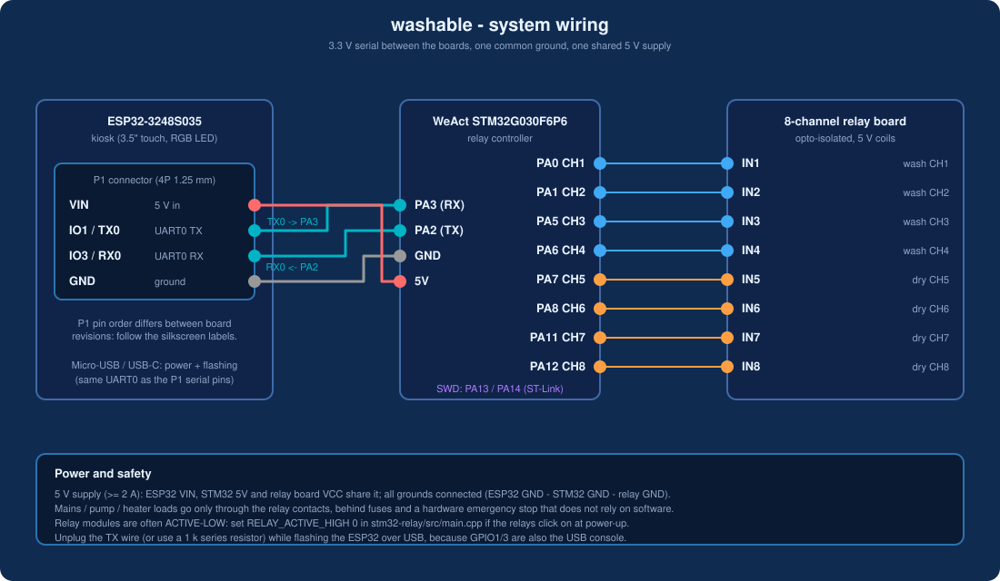

| ESP32-3248S035 (P1 connector) | STM32 (WeAct G030) | Note |
|---|---|---|
| IO1 / TX0 | PA3 (USART2 RX) | 3.3 V, 115200 8N1 |
| IO3 / RX0 | PA2 (USART2 TX) | 3.3 V |
| GND | GND | common ground, required |
| VIN (5 V) | 5V | one shared 5 V supply |

GPIO1/3 are the USB console too: log text on the wire is ignored by the controller, and while uploading ESP32 firmware over USB disconnect the TX wire (or use a 1 k series resistor).
The STM32 pin-to-relay mapping is in the [STM32 README](../stm32-relay/README.md).

### Communication

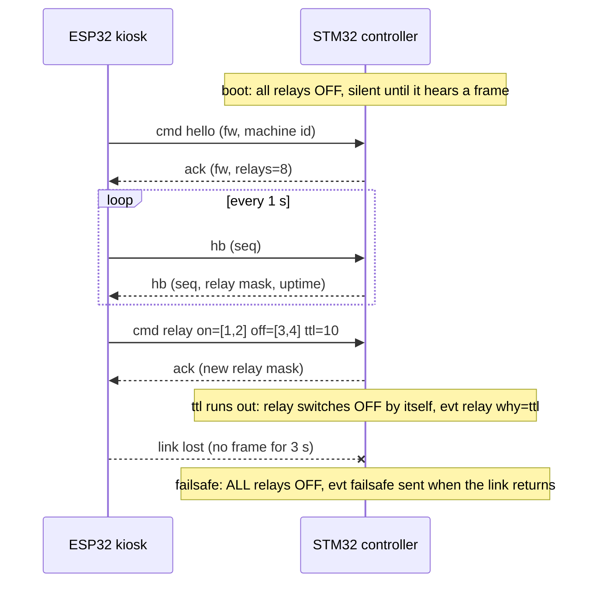

Frame format: `{json}*CRC16\n` (CRC-16/CCITT-FALSE), for example `{"v":1,"t":"hb","seq":42}*9ADA`. Details and error codes: [docs/relay-protocol.md](../docs/relay-protocol.md).

- **Health check**: Settings -> *Kesehatan STM32* runs a check in both directions (10 pings ESP32 -> STM32 with round-trip time, then the STM32 pings the ESP32 10 times, then the controller reports its counters and last restart reason) and shows one verdict (SEHAT / PERHATIAN / GANGGUAN) plus a checklist. Protocol: [docs/relay-protocol.md](../docs/relay-protocol.md#health-check-both-directions). `tools/stm32_sim.py` answers it too.
- **Status**: Settings -> *Tes relay* (6th row) shows the link state and lets the installer switch each of the 8 channels (20 s safety timer; everything off when you leave the page). The Info card shows "Kontroler relay: terhubung (fw ...)".
- **Cycles drive the relays**: each cycle keeps its channels on through the controller (re-asserted every 5 s with a 20 s safety `ttl`), the cycle clock pauses while the controller does not confirm them, a running cycle survives a restart, and "Bayar QRIS" is disabled while the controller is offline (not in demo mode). The per-phase table (`WASH_PHASES` / `DRY_PHASES` in `main.cpp`) is still a placeholder (main motor only); see [docs/production-readiness.md](../docs/production-readiness.md).
- **STM32 firmware**: [`stm32-relay/`](../stm32-relay/) (PlatformIO, STM32duino, board definition for the WeAct G030F6P6). Relay outputs `PA0, PA1, PA5, PA6, PA7, PA8, PA11, PA12` = channels 1-8 (check against your board before connecting loads), active-high by default (`RELAY_ACTIVE_HIGH`). Build `cd stm32-relay && pio run`, flash with an ST-Link `pio run -t upload`.
- **Tests without hardware**: `tests/run_host_tests.sh` from the repo root (controller logic, and this firmware's link code against the controller core), and `tools/stm32_sim.py` (pretends to be the STM32 over the ESP32 USB cable).

## Serial debug keys (115200 baud)

**Compiled out by default** (add `-DDEBUG_KEYS=1` to `build_flags` for bench work and remove it before a release); the production build ignores them (noise or a device on the UART must never be able to switch relays or skip the OTA gate). Because the serial port is shared with the relay link, a debug key is a **line starting with `#`** (type `#h` and press Enter; send a newline). Plain keys are ignored.

`0`-`9` jump to a screen (0 idle, 1 service, 2 cycle, 3 pay, 4 success, 5 run, 6 done, 7 PIN, 8 settings, 9 Wi-Fi),
`w` / `d` run a wash / dry cycle, `a` member question, `f` phone, `k` checking, `l` code, `h` member home,
`e` / `p` text / PIN editor, `o` force an OTA check, `O` skip the OTA install gate,
`t` relay test page, `r` toggle relay 1 (10 s), `x` all relays off.
The log also prints refresh rates and LED state changes.

## Project layout

```
esp32-kiosk/
  platformio.ini      board, pinned platform, LVGL / TFT_eSPI flags, partition table
  src/main.cpp        UI, flows, settings, web form, membership, LED
  src/ota.cpp/.h      OTA check, download, verification, rollback guard
  src/relay_link.cpp  serial JSON link to the STM32 relay controller
  src/version.h       FW_VERSION (rewritten by tools/release.py / the release workflow)
  src/fonts/          Fredoka + Nunito (OFL) as LVGL fonts
  data/cert/          CA certificate bundle embedded for HTTPS
../shared/relay_proto/  protocol helpers shared with the STM32 firmware (added with -I in platformio.ini)
../docs/relay-protocol.md  the protocol
../tools/release.py    builds firmware.bin + manifest.json
../tools/stm32_sim.py  pretends to be the STM32 on a serial port (for testing)
```

Libraries: LVGL 8.3, TFT_eSPI. Fonts: Fredoka and Nunito (SIL Open Font License).

## Known limitations

- The QR on the pay page is a fixed sample QRIS payload; dynamic QRIS from a payment API is not wired in yet.
- Membership uses demo data (see above).
- OTA images are not signed yet.
- The firmware uses about 88% of a 1.9 MB OTA slot, so keep an eye on size when adding features.

## Animation performance

Measured on the board (frames per second of the UI, before -> after): idle 16 -> 41, service 23 -> 58, pay 21 -> 44, success 22 -> 40, washing 17 -> 36, drying 22 -> 48, done 25 -> 45.
The display transfer was never the bottleneck (DMA); the CPU time in LVGL's software renderer was. What changed:

- LVGL's hot drawing code runs from **IRAM** (`LV_ATTRIBUTE_FAST_MEM=IRAM_ATTR`) and the flash runs in **QIO** mode (`platformio.ini`).
- The display flush keeps the SPI transaction open and overlaps the DMA transfer with rendering of the next strip.
- **Waves** are drawn by one custom draw callback (a two-harmonic sine surface, only a thin crest band is redrawn) instead of a row of moving circles.
- Bubbles, foam and heat bars skip updates when their integer position did not change and change their opacity in 16 steps instead of every frame, because every style change or move invalidates areas and costs a full object-tree walk.
- Render strips are 40 lines (DMA heap) instead of 24.

The log prints `frames/s`, render time per frame (`handler`) and the DMA wait every 2 s. `tools/sim/screenshots.sh bench` renders the same screens on a PC (relative profiling with `sample`/`perf`).
Layout check: `tools/sim/screenshots.sh` renders every page in **both languages** (`docs/img/screens/` and `docs/img/screens-en/`) and runs a **layout linter** over each (in English it also flags leftover Indonesian words) (text crossing a card edge, text beyond the screen, truncated or overlapping text, text covered by another object) and prints `LINT total: 0` when clean.
