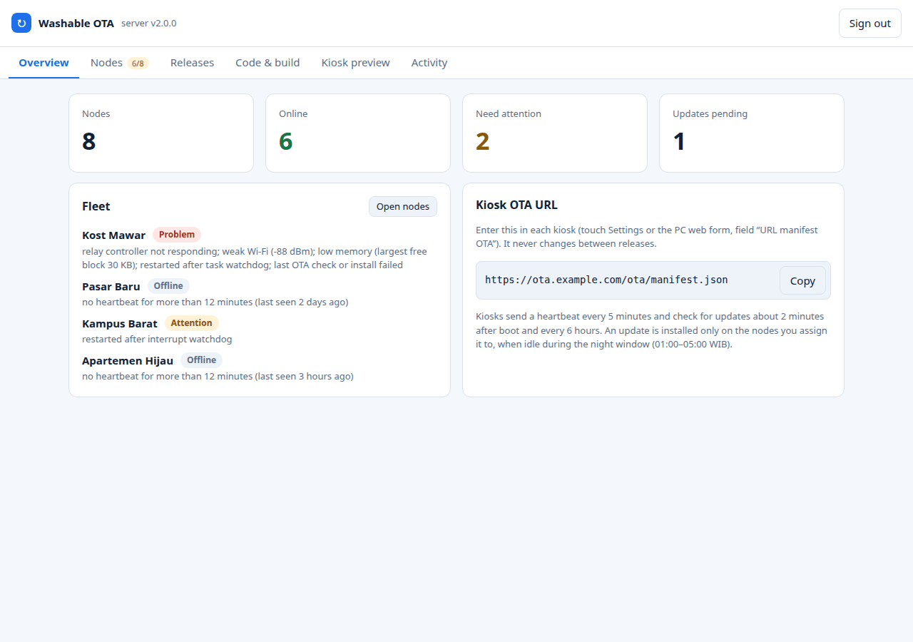
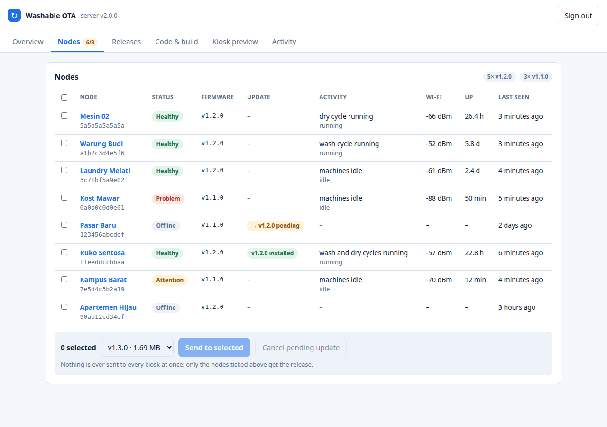
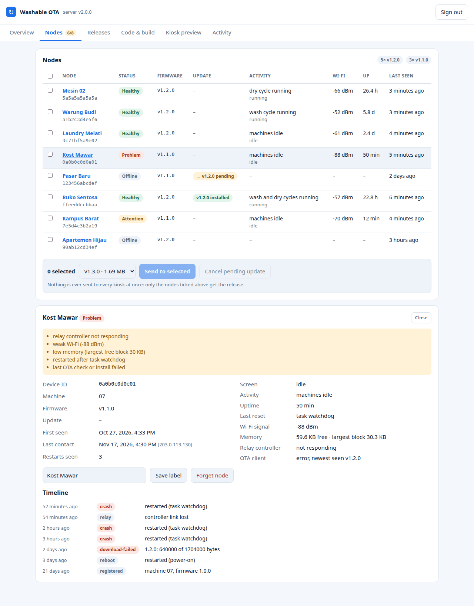
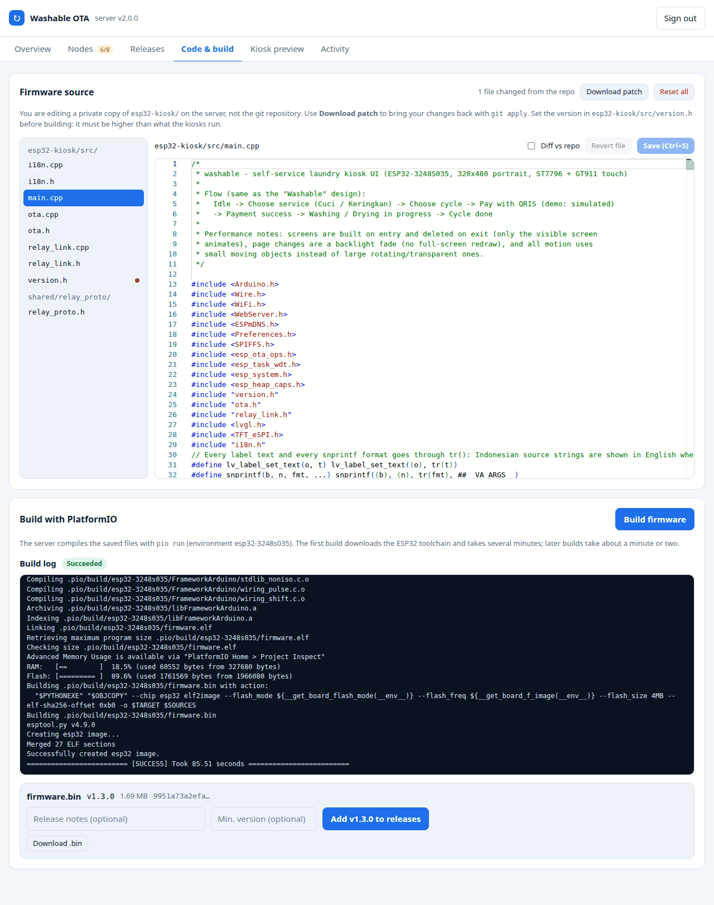
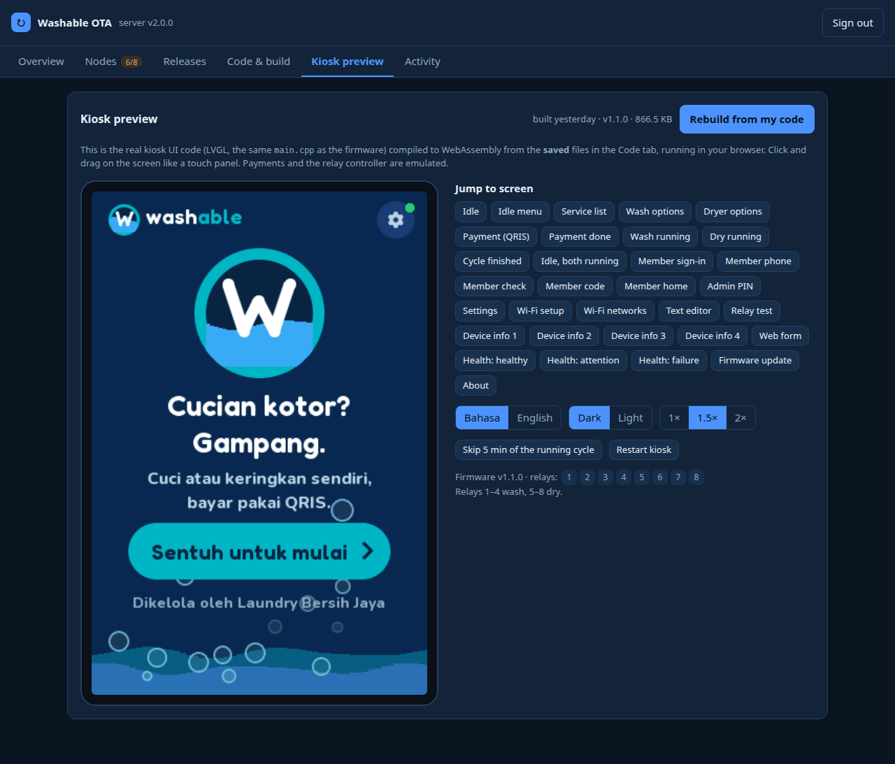
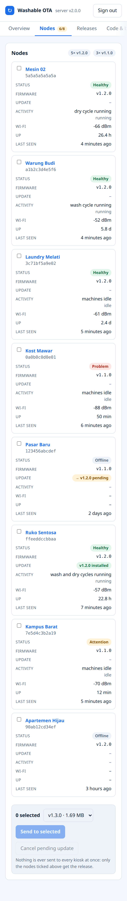
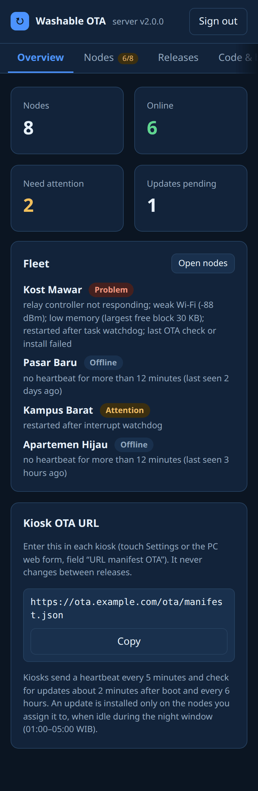

# ota-dashboard

Admin UI for [`ota-server`](../ota-server/README.md). Next.js 15 (static page, everything runs in the browser), deploys to Vercel as is.

| Tab | What it does |
|---|---|
| Overview | fleet counts (online, need attention, updates pending), problems at a glance, the kiosk OTA URL |
| Nodes | every kiosk that reported in: status, firmware, activity, Wi-Fi, uptime, last seen; click one for health details and its timeline; tick nodes and **send a release to only those** (there is no "all kiosks" button) |
| Releases | stored firmware images, download/delete, manual `.bin` upload |
| Code & build | Monaco editor on a private copy of the firmware source, diff against the repo, **PlatformIO build** with a live log, one click to add the result to Releases |
| Kiosk preview | the real kiosk UI compiled to WebAssembly from your edited code, clickable in the browser (screens, language, theme, fast-forward a cycle) |
| Activity | fleet timeline (reboots, crashes, firmware changes, downloads) and raw requests |

The browser talks **directly** to the backend (through the Cloudflare tunnel), so firmware uploads never pass through a Vercel function
(Vercel limits request bodies to 4.5 MB). Login is the backend's admin password; the session token is kept in `localStorage`.

## Vercel

Import the repo, set **Root Directory** to `ota-dashboard`, framework Next.js (auto-detected), and add one environment variable:

| Name | Value |
|---|---|
| `NEXT_PUBLIC_API_URL` | public https URL of the Cloudflare tunnel, no trailing slash, e.g. `https://ota.example.com` |

Then add the Vercel URL to `ALLOWED_ORIGINS` in `ota-server/.env` and restart the backend (`systemctl --user restart washable-ota`).
`NEXT_PUBLIC_*` variables are inlined at build time: redeploy after changing it.

## Local development

```bash
cd ota-dashboard
npm install
NEXT_PUBLIC_API_URL=http://localhost:8787 npm run dev      # http://localhost:3000, allowed by the backend's default ALLOWED_ORIGINS
```

## Demo mode

The login page has a **Try the demo (sample data)** button. It opens the dashboard on made-up data with no server at all (so it also works on the public Vercel site): eight nodes with health and timelines, three-release history, assigning updates, the Code tab on the real firmware sources, a simulated build, uploads, and the interactive kiosk preview. Everything lives in memory and resets on reload.

How it works: `lib/demo.ts` answers the same API calls as the real server when the session token is `demo`. The files it serves are in `public/demo/` (the compiled kiosk preview `sim.js` and copies of the firmware sources). After changing the kiosk firmware or rebuilding the preview, refresh them with `node scripts/sync-demo.mjs` and commit the result. Do not run it after putting a real merchant QRIS into `main.cpp`: the compiled preview would carry it.

## Screenshots

Every page in four setups (desktop and phone, light and dark theme), plus every kiosk page rendered through the Kiosk preview, is in [`docs/img/dashboard`](../docs/img/dashboard/README.md) (all data is made up). A few of them:

<table>
<tr>
<td><a href="../docs/img/dashboard/desktop-light/03-overview.png"></a><br><sub>Overview</sub></td>
<td><a href="../docs/img/dashboard/desktop-light/04-nodes.png"></a><br><sub>Nodes: status, firmware, activity, Wi-Fi; tick nodes to send a release</sub></td>
</tr>
<tr>
<td><a href="../docs/img/dashboard/desktop-light/06-node-problem.png"></a><br><sub>One node: issues, health, timeline</sub></td>
<td><a href="../docs/img/dashboard/desktop-light/15-code-built.png"></a><br><sub>Code &amp; build: editor, PlatformIO build, add to releases</sub></td>
</tr>
<tr>
<td><a href="../docs/img/dashboard/desktop-dark/18-preview-idle.png"></a><br><sub>Kiosk preview (dark theme)</sub></td>
<td><a href="../docs/img/dashboard/mobile-light/04-nodes.png"></a> <a href="../docs/img/dashboard/mobile-dark/03-overview.png"></a><br><sub>On a phone</sub></td>
</tr>
</table>

They are regenerated with [`tools/dashboard-shots/run.sh`](../tools/dashboard-shots/README.md) (a throwaway server with demo data and a real browser), so they can be refreshed after any UI change.

## Uploading a release

Either build it in the **Code & build** tab (set `FW_VERSION` in `version.h`, **Build firmware**, **Add to releases**), or upload a file in **Releases**:
`python3 tools/release.py 1.3.0` (or `pio run -d esp32-kiosk`) writes `dist/firmware.bin`; the browser checks it (size, ESP32 header, checksum, embedded OTA client and version) and the server checks again.
Then open **Nodes**, tick the kiosks that should get it, pick the release and **Send to selected**. Each of them installs it on its own during the night window (01:00-05:00 WIB) when idle, and the node row turns to "installed" when its heartbeat reports the new version.

Nodes need firmware **1.3.0 or newer** (device ID + heartbeat). Flash it once over USB; older kiosks are not listed and cannot be targeted.
