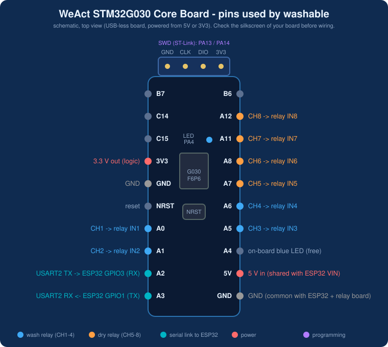
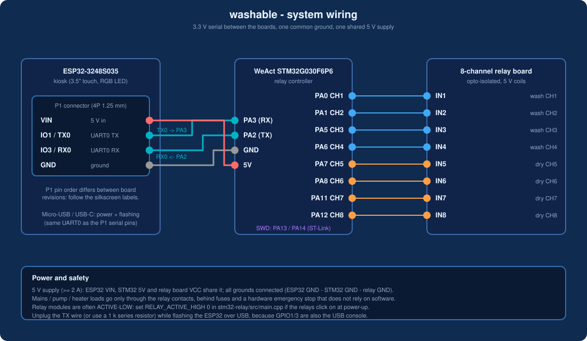
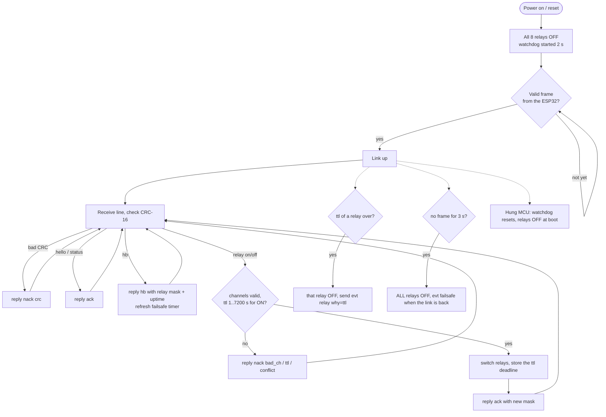
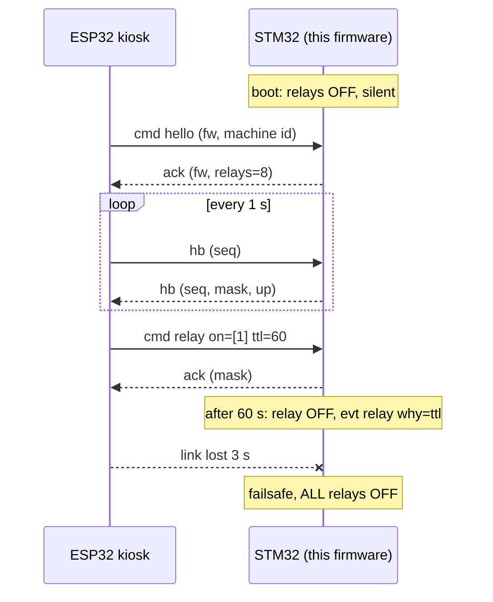

# washable - STM32 relay controller

Firmware for a **WeAct Studio STM32G030F6P6** core board (Cortex-M0+, 32 KB flash, 8 KB RAM) that switches 8 relays for the washable kiosk:
channels 1-4 wash machine, 5-8 dryer. It talks JSON lines to the kiosk ESP32 over USART2 and enforces the safety rules itself.
Part of the [washable monorepo](../README.md); protocol: [../docs/relay-protocol.md](../docs/relay-protocol.md).

## The board

[WeAct STM32G030 Core Board](https://docs.zephyrproject.org/latest/boards/weact/stm32g030_core/doc/index.html): STM32G030F6P6 (TSSOP-20, 64 MHz, 32 KB flash, 8 KB RAM), SWD header (GND, CLK/PA14, DIO/PA13, 3V3), one blue user LED on **PA4**, NRST button, on-board LDO (5 V in or 3.3 V in).
There is **no on-board debugger**: flash it with an ST-Link (or any SWD probe).

<p align="center"><br><sub>Photo: Zephyr Project documentation</sub></p>

### Pins used by this firmware



| Function | Pin | Connected to |
|---|---|---|
| Relay channel 1 (wash) | PA0 | relay board IN1 |
| Relay channel 2 (wash) | PA1 | IN2 |
| Relay channel 3 (wash) | PA5 | IN3 |
| Relay channel 4 (wash) | PA6 | IN4 |
| Relay channel 5 (dry) | PA7 | IN5 |
| Relay channel 6 (dry) | PA8 | IN6 |
| Relay channel 7 (dry) | PA11 | IN7 |
| Relay channel 8 (dry) | PA12 | IN8 |
| USART2 TX | PA2 | ESP32 GPIO3 (RX0) |
| USART2 RX | PA3 | ESP32 GPIO1 (TX0) |
| Power | 5V, GND | shared 5 V supply and common ground |
| Programming | PA13 / PA14 (SWD) | ST-Link |

PA4 (blue LED), PB6/PB7, PC14/PC15 are left free. These pins exist on the WeAct board's headers (the chip's `PB0/PB1` share a pad with `PA8` and are not broken out). The mapping is one array, `RELAY_PIN`, in `src/main.cpp`.
115200 8N1, 3.3 V logic. **Check the pins against your board's silkscreen before connecting loads.**
Relays are active-high by default (`RELAY_ACTIVE_HIGH`); many relay modules are active-low, set it to 0 if the relays click on at power-up.
Use an opto-isolated relay board, fuses, and a hardware emergency stop that does not depend on software.
ESP32 GPIO1/3 are also its USB console: disconnect the TX wire (or use a 1 k series resistor) while you upload firmware to the ESP32.

Complete system wiring (ESP32, STM32, relay board, power):



## Flow process

What the controller does from power-up (all of it is in `src/ctrl_core.h`, host-tested):



### Safety rules

1. All relays off at power-up and after every reset; independent watchdog enabled.
2. No valid frame for 3 s -> all relays off.
3. Every "on" needs a time limit (`ttl`, 1..7200 s) and switches off by itself.
4. Silent until it has heard the ESP32 (so flashing the ESP32 over the shared USB lines is not disturbed).

## Communication with the ESP32

Newline-delimited JSON with a CRC, 115200 8N1, 3.3 V, on USART2 (PA2 TX / PA3 RX) <-> ESP32 UART0 (GPIO3 RX / GPIO1 TX).



Example frames (`{json}*CRC16`):

```
{"v":1,"id":1,"t":"cmd","op":"hello","fw":"1.1.0","machine":"03"}*F787
{"v":1,"id":12,"t":"cmd","op":"relay","on":[1,2],"off":[3,4],"ttl":10}*EA17
{"v":1,"t":"hb","seq":42}*9ADA
{"v":1,"t":"nack","id":13,"err":"bad_ch"}*356C
```

The full command and reply list, error codes and the CRC definition are in [../docs/relay-protocol.md](../docs/relay-protocol.md).
The kiosk side is `esp32-kiosk/src/relay_link.cpp`; the **Tes relay** page in the kiosk settings switches the 8 channels one by one for installation.

## Build and flash

```bash
pio run                 # build (24 KB flash, 1.5 KB RAM)
pio run -t upload       # flash with an ST-Link over SWD (see upload_protocol in platformio.ini for other probes)
```

Wire the ST-Link to the SWD header: GND, CLK (PA14), DIO (PA13), 3V3 (optional, powers the board).
`boards/weact_g030f6p6.json` defines the board for PlatformIO (the framework already has the generic G030F6P variant, where `Serial` is USART2 on PA2/PA3).

## Tests

`python3 test/test_controller.py` (from this folder, or `./tests/run_host_tests.sh` from the repo root) compiles `src/ctrl_core.h` for the host and checks the handshake, safety timer, heartbeat loss, error replies and the silence rules.
`../tools/stm32_sim.py` does the opposite job: it pretends to be this controller so the ESP32 can be tested without the board.

## Layout

```
platformio.ini      env for the WeAct G030F6P6 (STM32duino)
boards/             PlatformIO board definition
src/ctrl_core.h     protocol + safety logic (hardware independent, host-tested)
src/main.cpp        USART2, relay pins, watchdog, main loop
test/               host test driver + test script
../shared/relay_proto/relay_proto.h   framing / CRC / parsing shared with the ESP32 firmware
```
